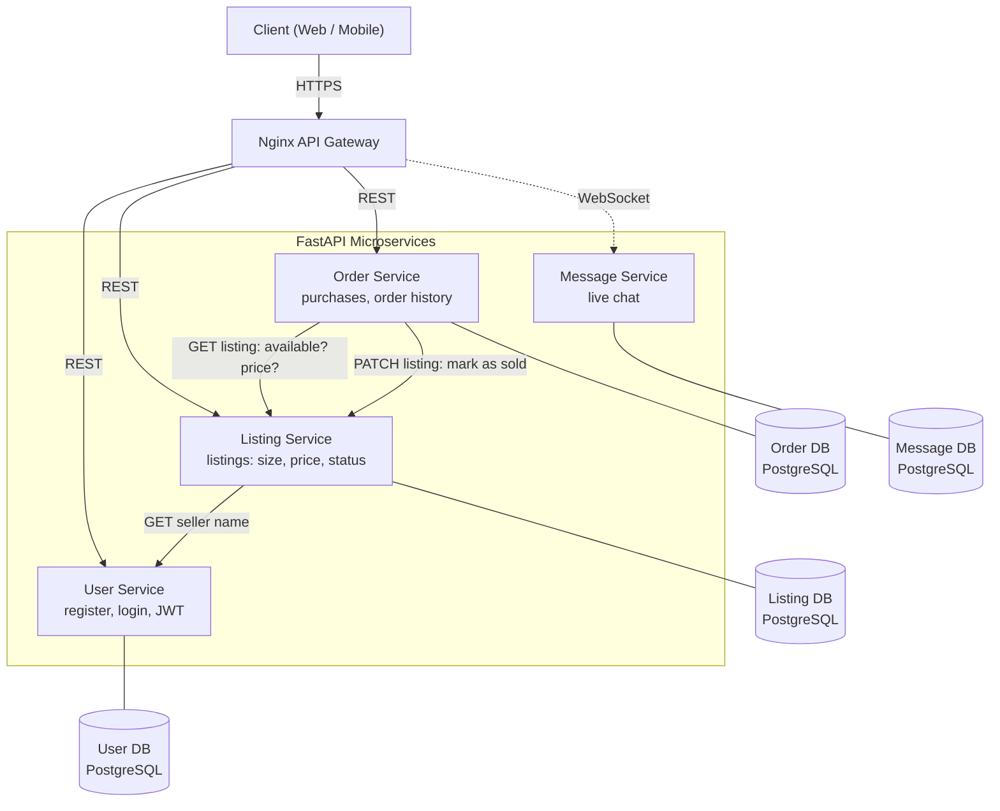
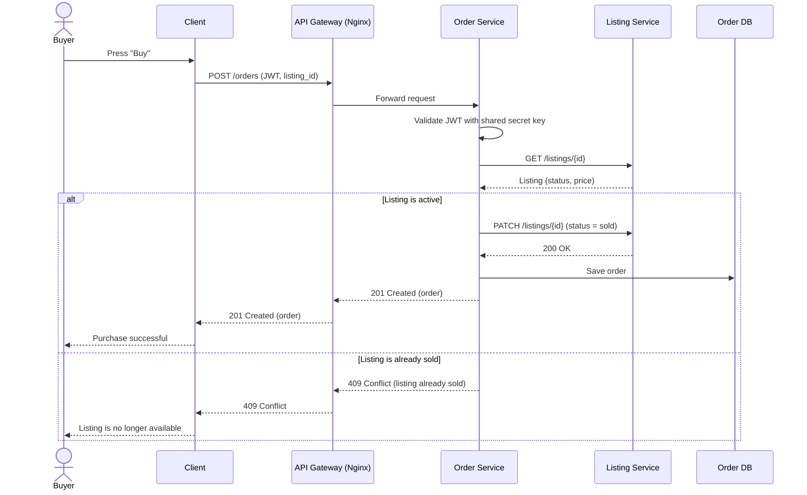

# Architecture

Second-hand clothing marketplace built as four independent FastAPI microservices. Each service owns its own PostgreSQL database, and no service accesses another service's database.

## 1. System Overview

Clients send every request through the Nginx API Gateway. Services talk to each other over REST/HTTP. Each service validates the JWT itself using a shared secret key, so none of them calls the User Service to check a token.

## 2. Purchase Flow

When a buyer presses "Buy", the Order Service verifies the JWT locally, checks the listing, and either completes the purchase or returns an error.

